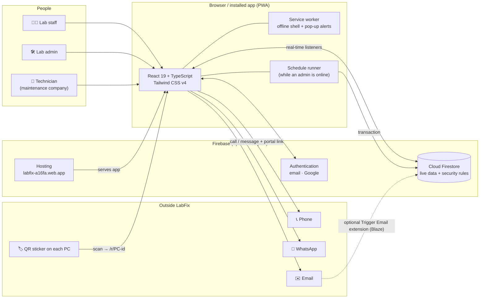
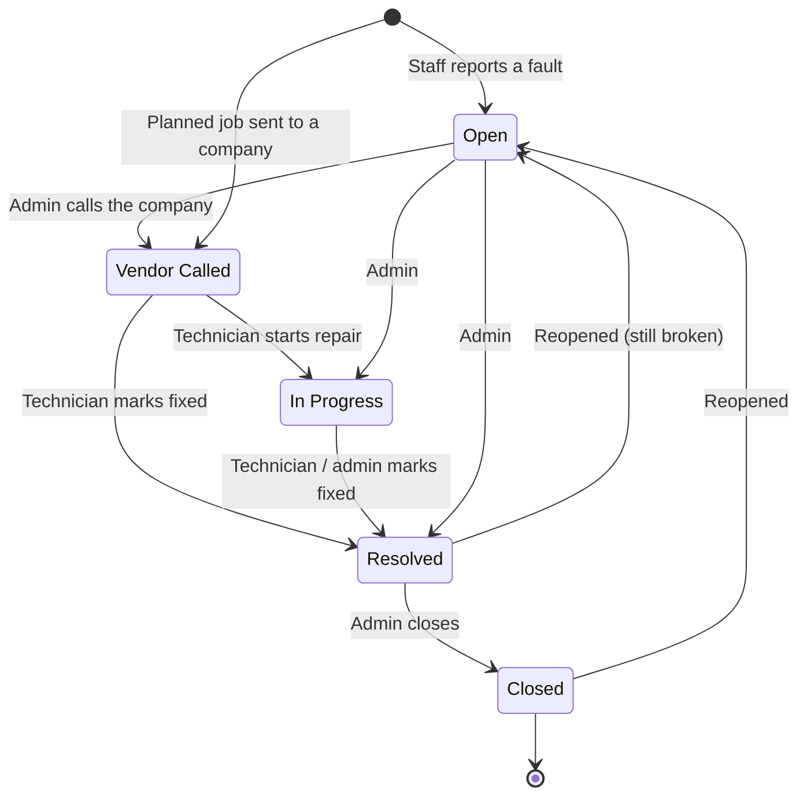
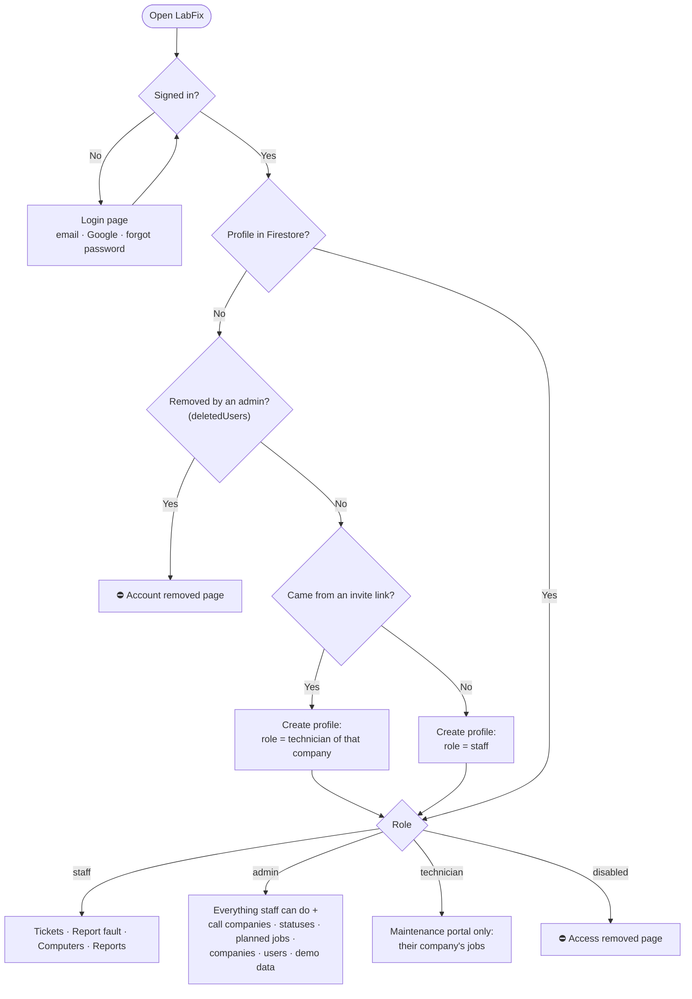
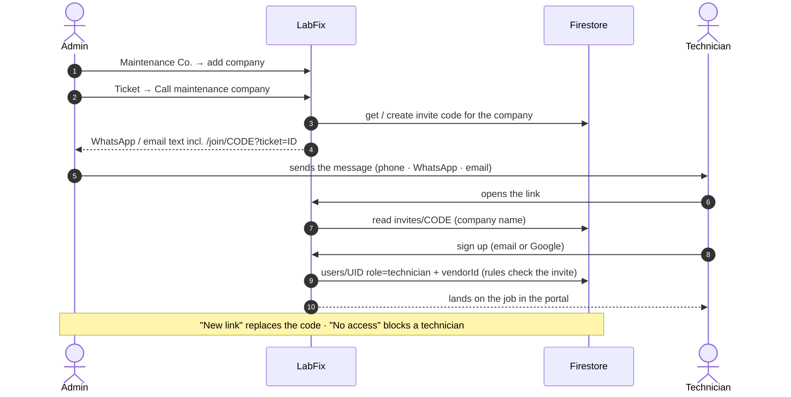
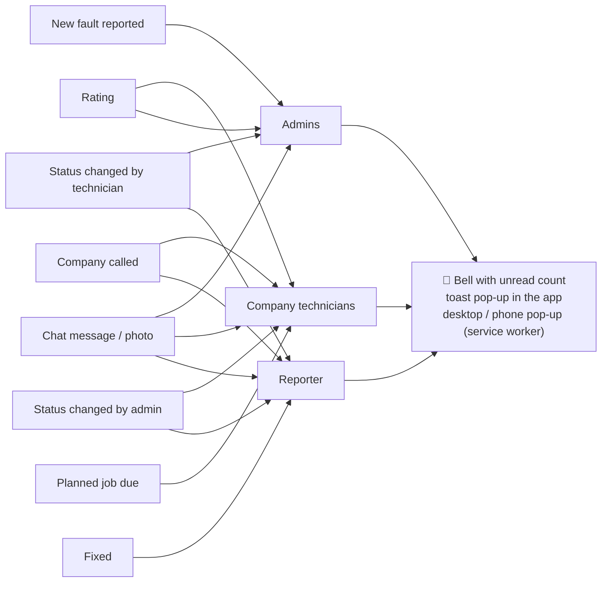
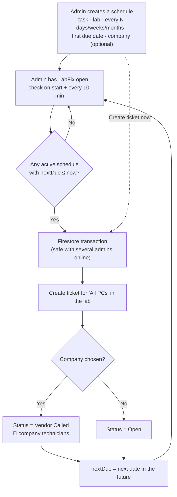
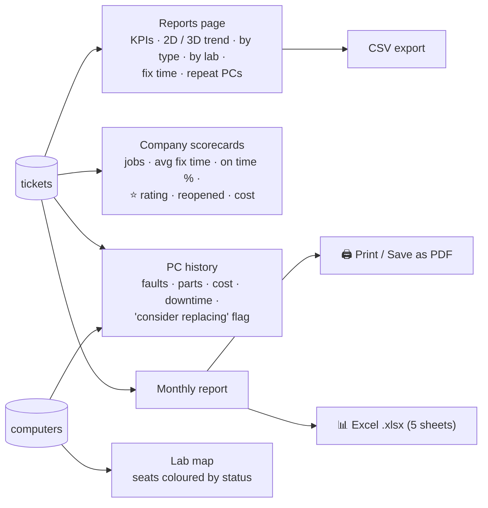
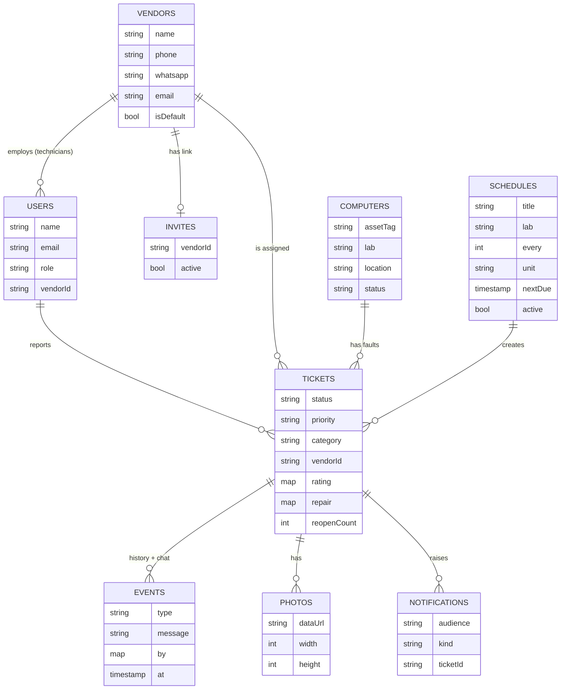

# LabFix – System flowcharts

How LabFix works, end to end. The diagrams are written in [Mermaid](https://mermaid.js.org), so GitHub draws them automatically.

- [1. System architecture](#1-system-architecture)
- [2. Complete repair flow](#2-complete-repair-flow)
- [3. Ticket status lifecycle](#3-ticket-status-lifecycle)
- [4. Sign-in, roles and access](#4-sign-in-roles-and-access)
- [5. Maintenance company onboarding](#5-maintenance-company-onboarding)
- [6. Alerts: who is told what](#6-alerts-who-is-told-what)
- [7. Planned maintenance](#7-planned-maintenance)
- [8. Reports, scorecards and exports](#8-reports-scorecards-and-exports)
- [9. Data model](#9-data-model)

---

## 1. System architecture

---

## 2. Complete repair flow

```mermaid
flowchart TD
    START(["💥 A lab PC breaks"]) --> HOW{How is it reported?}
    HOW -- "Scan QR sticker" --> QR["/r/PC-id opens the report form<br/>with the PC already chosen"]
    HOW -- "Open LabFix" --> PICK["Report Fault → choose lab and PC"]
    QR --> SIGNED{Signed in?}
    PICK --> FORM
    SIGNED -- No --> LOGIN["Sign in / sign up<br/>(email or Google)"] --> FORM
    SIGNED -- Yes --> FORM
    FORM["Report form<br/>problem type · priority · summary · details · up to 4 photos"]
    FORM --> DUP{"PC already has<br/>an open ticket?"}
    DUP -- Yes --> WARN["Warning + link to that ticket<br/>(comment there instead)"] --> SUBMIT
    DUP -- No --> SUBMIT["Submit"]
    SUBMIT --> TK["Ticket = Open<br/>PC = Faulty<br/>fix deadline starts (SLA)"]
    TK --> AL1["🔔 Alert to all admins"]
    AL1 --> ADM["Admin opens the ticket"]
    ADM --> CALL["📞 Call maintenance company<br/>phone · WhatsApp · email<br/>message + portal link filled in"]
    CALL --> VC["Ticket = Vendor Called<br/>company assigned · 🔔 company + reporter"]
    VC --> TECH{"Technician has<br/>an account?"}
    TECH -- No --> JOIN["Opens portal link<br/>signs up under that company"] --> PORTAL
    TECH -- Yes --> PORTAL["Maintenance portal<br/>sees only their company's jobs"]
    PORTAL --> START_R["Start repair<br/>Ticket = In Progress · PC = Under Repair"]
    START_R --> CHAT["💬 Chat with the lab<br/>📷 add photos"]
    CHAT --> FIX["Mark as fixed<br/>note · parts replaced · cost (RM)"]
    FIX --> RES["Ticket = Resolved<br/>PC = Working · 🔔 reporter + admins"]
    RES --> OK{"Works for the lab?"}
    OK -- No --> REOPEN["Admin reopens<br/>reopen count +1"] --> TK
    OK -- Yes --> RATE["Reporter rates the repair ⭐ 1–5"]
    RATE --> CLOSE["Admin closes the ticket"]
    CLOSE --> STATS[("Reports · company scorecards<br/>PC history · monthly report")]
    STATS --> END(["✅ Done"])
```

---

## 3. Ticket status lifecycle

| Ticket status | PC status | Who can move it |
|---|---|---|
| Open | Faulty | staff create · admin any move |
| Vendor Called | Faulty | admin (by calling the company) |
| In Progress | Under Repair | technician of the assigned company, admin |
| Resolved | Working | technician of the assigned company, admin |
| Closed | Working | admin |

Fix deadline (SLA) from the moment it is reported: **critical 4 h · high 24 h · medium 3 days · low 7 days**.

---

## 4. Sign-in, roles and access

All of this is enforced on the server by [firestore.rules](../firestore.rules), not only hidden in the UI.

---

## 5. Maintenance company onboarding

---

## 6. Alerts: who is told what

Alerts are saved in `notifications` with an `audience` of `admins`, `user:<uid>` or `vendor:<companyId>`, in the same write as the change that caused them. The text is built when shown, so each person reads it in their own language.

---

## 7. Planned maintenance

---

## 8. Reports, scorecards and exports

---

## 9. Data model

